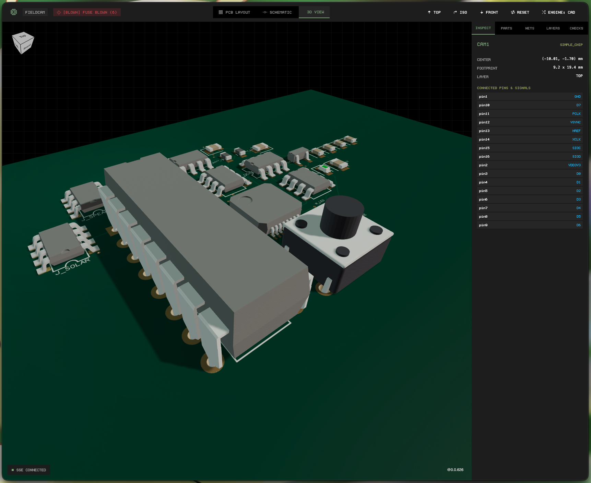
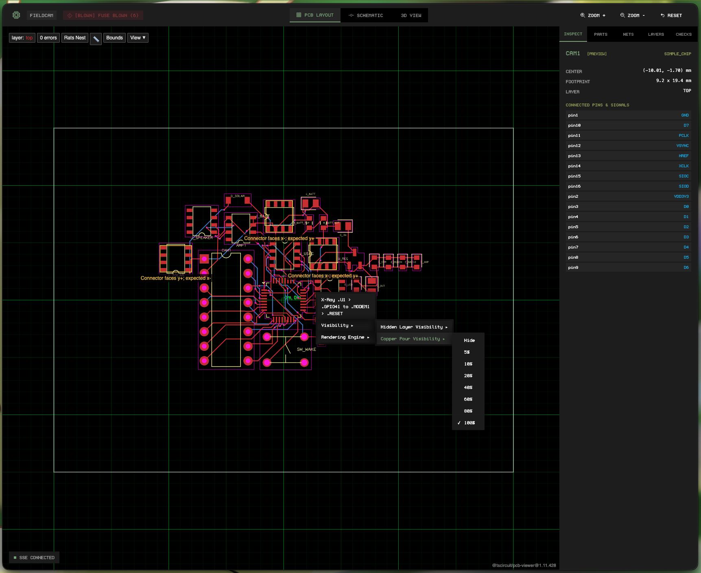

# Fusible

> **The fuse for your firmware.** An electronic linter and tscircuit project manager in Rust:
> it reads the Circuit JSON generated by [tscircuit](https://tscircuit.com), checks the
> electrical and physical rules of the board, and when a rule fails, **the
> fuse blows**: the process exits with an error and firmware code generation
> never happens.

Fusible unifies hardware and firmware into a single monorepo contract using `fusible.yml`,
wrapping development servers, dark-theme web previewers, artifact exports, and firmware codegen.




## Project status

| Phase | Scope | Status |
|---|---|---|
| 1 (MVP) | CLI, Circuit JSON parser, rules engine, diagnostics | shipped |
| 1.1 | Project manifest (`fusible.yml`), toolchain detection, package manager | shipped |
| 2 | Silicon pin-muxing (`src/silicon/`) for STM32, RP2040, ESP32-S3 | shipped |
| 2 | Firmware codegen (`src/codegen/pins.rs`) for Embassy / Cortex-M | shipped |
| 2.1 | Pure-Rust RS-274X Extended Gerber & Excellon drill generator | shipped |
| 2.2 | Pure-Rust vector documentation exporter (PCB & schematic SVGs) | shipped |
| 2.3 | Native Fusible Studio dev server with dark theme and live SSE reload | shipped |
| 2.4 | Deterministic autorouter and bidirectional KiCad syncer | shipped |
| 2.5 | Fuse-gated 3D enclosure generator (`mechanical`) on OpenCascade | shipped |

## Prerequisites

For pure Circuit JSON projects, Gerber exports, SVG rendering, and linter checks, Fusible runs with **zero external dependencies**.

To compile React `.tsx` circuits or export 3D STEP models, install `tscircuit` globally or in your workspace:

```sh
# Using bun:
bun add -g tscircuit

# Or using npm:
npm install -g tscircuit
```

Inspect toolchain health anytime with `fusible doctor` (or run `fusible doctor --install` to provision it).

## Installation

```sh
cargo install fusible
```

## Quick start (monorepo)

Initialize a new hardware + firmware project:

```sh
fusible init --name sensor-node
```

This creates a minimal `fusible.yml`:

```yaml
name: sensor-node

hardware:
  entry: hardware/index.tsx
  out_dir: dist
  port: 3020

mcu:
  chip: stm32g431

firmware:
  path: firmware
  framework: embassy
  pins_rs: firmware/src/pins.rs
  build_cmd: cargo build
```

## Commands

### 1. Electrical linter (`check`)

```sh
fusible check                     # uses fusible.yml entry
fusible check hardware/index.tsx  # compiles .tsx on the fly and lints
fusible --input circuit.json      # direct Circuit JSON input
fusible check --mcu stm32g431     # validates alternate functions against silicon
```

Clean circuit (exit code 0):

```
Circuit validated (fuse intact)
```

Rule violated (exit code 1):

```
the fuse blew: 1 electrical violation(s)
[unconnected_net] net "I2C_SDA" has only 1 connection(s) (minimum 2): it is floating
help: every net must connect at least two pads/ports: complete the routing in tscircuit
```

### 2. Fusible Studio dev server (`dev` / `view` / `webview`)

Starts the native dark-theme web previewer powered by an embedded Rust HTTP server and live-reload event streamer:

```sh
fusible dev                       # launches native Fusible Studio on port 3020
fusible view --port 3030          # custom port
fusible dev --legacy              # fallback to legacy tsci dev server
```

Features:
- Instant startup with zero Node runtime required for Circuit JSON.
- Live-reload streaming via Server-Sent Events (SSE) with 150ms debounced filesystem watching.
- Vitrine brutalist dark UI palette (`#000000`, `#131313`, `#353535`, `#86A881`, `#A8B365`) and embedded `Undefined` monospace typography.
- Interactive pan and zoom vector canvas for multi-layer PCB layout (`01 // PCB LAYOUT`) and schematic diagrams (`02 // SCHEMATIC`).
- Interactive Three.js 3D board viewer (`03 // 3D VIEW`) rendering substrate, ENIG gold pads, copper vias, traces, and components with OrbitControls and view presets.
- Real-time fuse status badge (glowing green when intact, pulsing red on blown fuse).
- Diagnostics inspector showing rule violations, severity, and remediation advice.
- PCB layer visibility toggles (top copper, bottom copper, ENIG pads, silkscreen).

### 3. Autorouter (`route`)

Multi-layer A* autorouter on pure Rust spatial R-trees (`rstar`). Nets route one at a time in a fixed order, and each finished trace becomes an obstacle for the next, so routed nets cannot short:

```sh
fusible route                             # routes entry circuit and writes dist/circuit.routed.json
fusible route --dry-run                   # verifies all nets can be routed without writing files
fusible route -o dist/routed.json         # custom destination
fusible route --clearance 0.2 --layers 2  # custom clearance and layer count
```

When routing congestion prevents a trace from completing, **the fuse blows** (exit code 1) and lists unrouted nets to protect physical fabrication.

### 4. Bidirectional KiCad syncer (`diff` and `sync`)

Bi-directional layout reconciliation between graphical CAD tools (KiCad PCB) and declarative code (`tscircuit`):

```sh
# Compare component placement and report layout drift:
fusible diff path/to/board.kicad_pcb

# Synchronize physical moves and rotations back into manual-edits.json:
fusible sync path/to/board.kicad_pcb --write

# Dry run sync without modifying disk:
fusible sync path/to/board.kicad_pcb --dry-run
```

### 5. Build (`build`)

Evaluates the board, lints electrical rules, generates typed firmware pin bindings (`pins.rs`), and compiles firmware only if the fuse is intact:

```sh
fusible build
```

### 6. Fuse-gated deliverables (`export`)

Exports fabrication-ready Gerbers, KiCad projects, SVGs, 3D models (STEP/GLB), or documentation.
All exports are **fuse-gated**: electrical rules are verified first. If a rule fails, the fuse blows and no artifacts are produced.

```sh
# Presets:
fusible export --preset fab       # RS-274X Gerbers (.zip) + Circuit JSON via native Rust
fusible export --preset cad       # KiCad project (.zip) + 3D STEP (.step)
fusible export --preset docs      # Native PCB SVG + Schematic SVG (<5ms)
fusible export --preset all       # Generates all export bundles

# Specific format exports:
fusible export -f gerbers -o dist/gerbers.zip
fusible export -f pcb-svg -o dist/pcb.svg
fusible export -f step
fusible export -f kicad_zip

# Bypass verification (for debugging/drafts):
fusible export --preset fab --skip-lint
```

### 7. 3D enclosure (`mechanical` / `case`)

Generates a two-part enclosure (base + lid) around the board outline in Circuit JSON. The command is fuse-gated like `export`.

```sh
fusible mechanical                       # STEP into dist/mechanical/
fusible mechanical -f all                # step, stl, glb, and brep
fusible mechanical --ventilation grid    # vent holes in the lid (grid | slots)
fusible mechanical --wall-thickness 2.5 --height 25
fusible mechanical --no-cutouts --no-mounting
```

- The outline comes from `pcb_board` (`outline` points, or `width` x `height`).
- Each `pcb_hole` gets a screw boss with a pilot hole, and the board sits on the bosses.
- Components that reach the board edge get a wall notch from the board surface up.
- CLI flags override the `mechanical:` section of `fusible.yml`, which overrides defaults.
- Requires `bun`. The first run installs `occt-wasm` into `~/.cache/fusible/`. IGES is not supported.

### 8. Hardware package management (`add`, `install`, `search`)

Manage tscircuit packages, community footprints, and components without touching npm or tsci directly:

```sh
# Search footprints and components in the tscircuit registry:
fusible search esp32-s3

# Add a community component or registry footprint to hardware/:
fusible add @tsci/seveibar.smd-resistor

# Install all hardware dependencies:
fusible install
```

### 9. Toolchain diagnostics (`doctor`)

Inspects local toolchain health (`bun`, `node`, `npm`, `npx`, `tsci`) and verifies tscircuit runner availability:

```sh
fusible doctor
fusible doctor --install
```

## Exit codes

The codes are part of the contract, so CI can tell failures apart:

| Code | Meaning |
|---|---|
| `0` | Fuse intact: circuit validated / command succeeded |
| `1` | Electrical violations: the fuse blew, generation is blocked |
| `2` | Tool or usage error (unreadable/malformed input, bad arguments) |

## Architecture

```
src/
├── main.rs                 # CLI entry point, exit code mapping
├── cli.rs                  # Clap command definitions
├── assets/                 # Embedded dark-theme web dashboard & Undefined font
├── dev/                    # Native Fusible Studio dev server (tiny_http, SSE, notify)
├── router/                 # Deterministic multi-layer autorouter (rstar, A*)
├── kicad/                  # S-expression parser & bidirectional layout drift syncer
├── commands/               # Subcommand execution pipelines (check, dev, route, diff, sync, export, build)
├── config/                 # fusible.yml manifest loader and path resolution
├── gerber/                 # Pure-Rust RS-274X Gerber and Excellon drill generator
├── svg/                    # Pure-Rust vector renderers for PCB layout and schematics
├── silicon/                # Silicon database and alternate function pin multiplexer
├── codegen/                # Typed firmware pin bindings generator (pins.rs)
├── parser/                 # Serde Circuit JSON parser and source span tracking
├── linter/                 # Fail-closed rules engine and diagnostics
├── netlist/                # Bipartite graph IR of nets, components, ports, and traces
└── tscircuit/              # Runner discovery and external process control
```

## Development

```sh
mise install        # installs lefthook
cargo test          # test suite (85+ unit and integration tests)
cargo clippy --all-targets -- -D warnings
cargo fmt --all -- --check
```

## License

[MIT](LICENSE)
