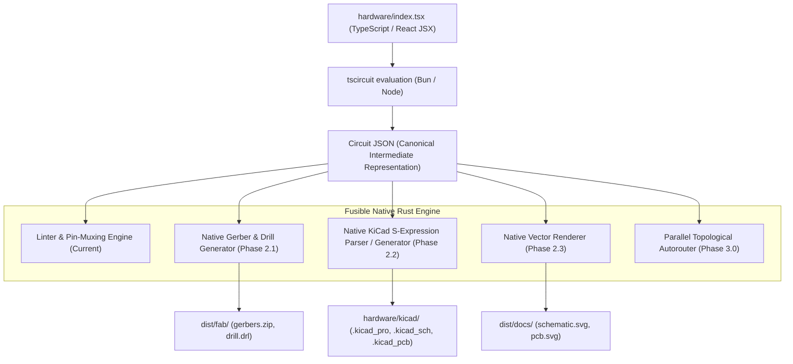

# Fusible Native Rust Architecture & Engine Migration Roadmap

> **Strategic Directive**: Progressively migrate compute-heavy, geometric, and serialization subsystems of the tscircuit toolchain into pure, zero-overhead Rust while preserving the declarative React/TSX component authoring experience.

---

## 1. Architectural Philosophy: The Separation of Concerns

Electronic CAD tools have two distinct layers:
1. **The Declarative Authoring Layer (Frontend DSL)**:
   - Defining component hierarchies, pin labels, and net connections (`<board>`, `<chip>`, `<resistor>`, `<trace>`).
   - TypeScript and React are ideal here: developers benefit from npm component libraries, TypeScript autocompletion, and JSX composability.
2. **The Computational & Serialization Pipeline (The Engine)**:
   - Parsing, electrical rule checking (DRC/ERC), pin-muxing, spatial indexing, trace autorouting, and manufacturing file generation (Gerbers, Excellon drills, KiCad S-expressions, SVGs).
   - In Node.js / Bun, this layer suffers from high memory consumption, single-threaded bottlenecks, and multi-second startup latency. In **Rust**, it executes deterministically in **sub-millisecond to tens-of-milliseconds** timeframes.

---

## 2. Migration Tiers & Prioritized Roadmap

### Tier 1: Native Gerber & Excellon Drill Generator (`fusible export --preset fab`)

* **Current Implementation**: Wraps `tsci export -f gerbers`, which spins up a JavaScript process loading dozens of npm modules (`circuit-to-gerber`, `gerber-to-svg`, etc.) taking 2–4 seconds.
* **Native Rust Implementation**:
  - `src/export/gerber/`: Direct RS-274X formatter.
  - Translates Circuit JSON pads, copper traces, solder masks, and silkscreen geometry directly into standard Gerber aperture definitions (`%ADD...%`) and draw/flash commands (`D01`, `D02`, `D03`).
  - Translates plated holes into standard Excellon format (`M48`, tool definitions, coordinate punches).
  - Bundles the output directly into `dist/fab/gerbers.zip` using `flate2` / `zip-rs`.
* **Impact**:
  - **Zero npm/runner dependency** for creating fabrication-ready manufacturing packages.
  - Execution time drops from **~3,000ms to < 5ms**.

---

### Tier 2: Native KiCad S-Expression Parser & Generator (`fusible sync`)

* **Current Implementation**: Employs an embedded Node/Bun script running `kicad-to-circuit-json`.
* **Native Rust Implementation**:
  - `src/export/kicad/`: S-expression tokenizer and AST for `.kicad_sch` and `.kicad_pcb`.
  - Serializes Circuit JSON into native KiCad 7/8 format.
  - Enables true bi-directional synchronization (`fusible sync` / `fusible diff`): reads changes made by Electrical Engineers in the KiCad visual layout and cleanly backports netlist and placement adjustments into `hardware/index.tsx`.
* **Impact**:
  - Eliminates external converter dependencies.
  - Instant round-trip collaboration between visual EDA and code-first hardware.

---

### Tier 3: Native Vector Rendering Engine (`fusible export --preset docs`)

* **Current Implementation**: Relies on headless browser / React SVG DOM rendering.
* **Native Rust Implementation**:
  - `src/export/svg/`: High-performance vector renderer mapping schematic symbols and PCB layers to crisp, standards-compliant SVG.
  - Renders schematic diagrams, pinout legends, and multi-layer PCB previews directly from the Circuit JSON graph.
* **Impact**:
  - Enables instant documentation previews on GitHub PRs and local documentation pipelines in **< 10ms**.

---

### Tier 4: The Parallel Multi-Core Autorouter (`fusible route`)

* **Current Implementation**: JavaScript-based capacity or maze routing (`@tscircuit/capacity-autorouter`), which is single-threaded and takes 15–90 seconds on dense boards.
* **Native Rust Implementation**:
  - `src/router/`: Gridless topological / A* pathfinder.
  - Utilizes **`rstar`** for 2D spatial indexing (R-trees) of clearance rules and copper keepouts.
  - Utilizes **`rayon`** for parallel multi-core route negotiation and rip-up/reroute iterations.
* **Impact**:
  - **100x–500x speedup** for board layout routing.
  - Can be exported as a standalone C-ABI / WebAssembly module for the broader open-source hardware community.

---

## 3. Recommended Phased Implementation Schedule

| Version | Milestone | Scope | External Dependency Removed |
| :--- | :--- | :--- | :--- |
| **v0.3.1** | *Baseline Hardening* | Explicit `tscircuit` prerequisite, removed `bun x` latency | `bun x` ephemeral execution |
| **v0.4.0** | *Native KiCad Engine* | S-expression parser/writer + `fusible sync` | `kicad-to-circuit-json` |
| **v0.5.0** | *Native Fabrication* | Pure Rust Gerber (RS-274X) & Drill (Excellon) exporter | `circuit-to-gerber` |
| **v0.6.0** | *Native Documentation* | Pure Rust SVG schematic & PCB layout generator | `circuit-to-svg` |
| **v1.0.0** | *Native Autorouting* | Parallel topological router with spatial R-trees | `@tscircuit/capacity-autorouter` |
